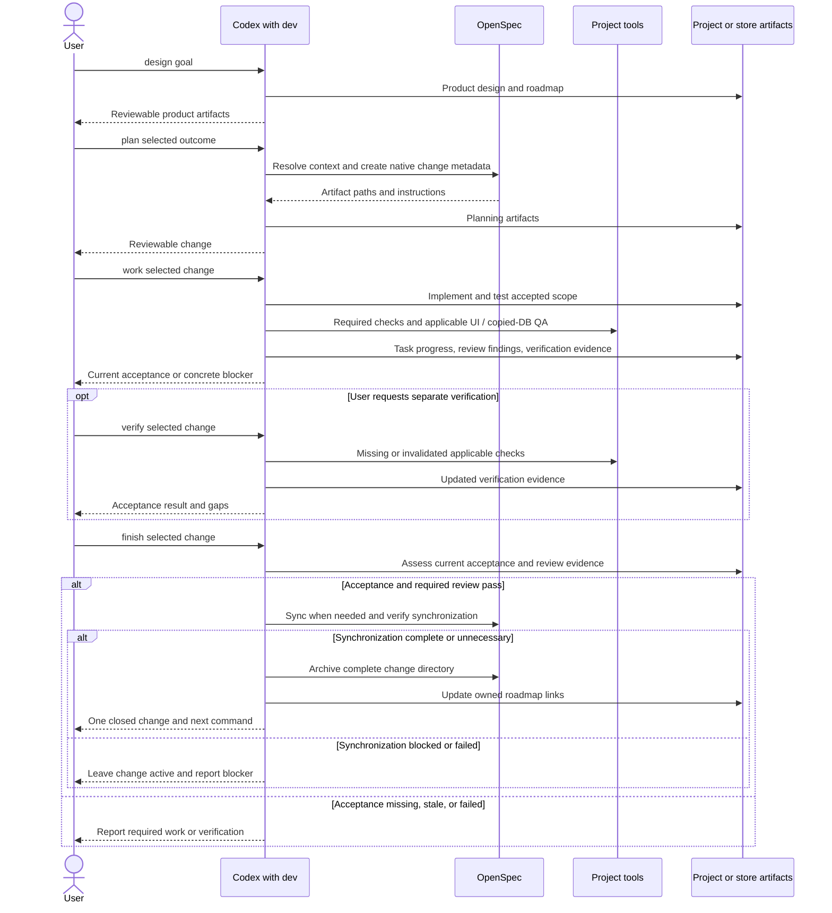

# Architecture and artifact guide

## Purpose

- Explain component responsibilities, file locations, artifact ownership, and the development lifecycle.
- Use this guide when learning or maintaining the library.
- Read [commands](commands.md) for operation contracts and [engineering](engineering-and-verification.md) for acceptance rules.

## Components and responsibilities

| Component | Responsibility |
| --- | --- |
| User | Select goals, outcomes, changes, and subsequent commands; resolve material decisions. |
| Codex | Execute the selected instructions, inspect artifacts, use project tools, and report observed results. |
| `$dev` package | Resolve the project/target, route commands, load relevant instructions, and preserve operation boundaries. |
| Product-planning reference | Guide product design, outcome roadmaps, adoption, and effort revision. |
| Installed OpenSpec skills and CLI | Own native schemas, metadata, artifact instructions, change lifecycle, and planning-store resolution. |
| Installed Ponytail skills | Supply actual development/review instructions according to command routing. |
| Project tooling | Build, test, run required UI/copied-database QA, and produce evidence. |
| Verification record | Retain tested identities, coverage, results, findings, and acceptance gaps for later assessment. |

- `$dev` is a Codex instruction package; it has no application runtime, daemon, scheduler, or task database.
- Each invocation resolves the current repository and explicit/unambiguous target; there is no global active-project pointer.
- State comes from current artifacts and evidence; recency and checkboxes alone do not establish completion.

## Global installation and files

Current installation:

```text
Source: /Users/po/codeandconfigs/dev-command-library
Link:   /Users/po/.agents/skills/dev
        -> /Users/po/codeandconfigs/dev-command-library/skills/dev

dev-command-library/
├── README.md
├── .gitignore
├── docs/implementation-plan.md
├── skills/dev/
│   ├── SKILL.md
│   ├── agents/openai.yaml
│   ├── references/
│   │   ├── architecture.md
│   │   ├── commands.md
│   │   ├── product-planning.md
│   │   ├── openspec-workflow.md
│   │   ├── engineering-and-verification.md
│   │   └── maintenance.md
│   └── assets/templates/
│       ├── design.md
│       ├── roadmap.md
│       └── verification.md
└── tests/
    ├── scenarios.md
    └── evidence/<run-id>.md
```

Package paths below are relative to `skills/dev/`.

| File | Purpose and use |
| --- | --- |
| [SKILL.md](../SKILL.md) | Entrypoint: target selection, shared rules, dependency loading, and authoritative skill routing; every invocation. |
| `agents/openai.yaml` | Discovery/display metadata and default prompt; currently starts with `$dev status`. |
| [references/architecture.md](architecture.md) | Structure, locations, ownership, and lifecycle; orientation and maintenance. |
| [references/commands.md](commands.md) | Inputs, actions, writes, and stop conditions; selected operation. |
| [references/product-planning.md](product-planning.md) | Product design, roadmap, adoption, and revision; `design` and `revise --effort`. |
| [references/openspec-workflow.md](openspec-workflow.md) | Native workflow integration; setup, planning, work, revision, verification/status, and finish. |
| [references/engineering-and-verification.md](engineering-and-verification.md) | Architecture, implementation, QA, review, and evidence requirements; design through completion. |
| [references/maintenance.md](maintenance.md) | Installation, updates, validation, recovery, and removal; library maintenance. |
| [assets/templates/design.md](../assets/templates/design.md) | Starting structure when no suitable canonical product design exists. |
| [assets/templates/roadmap.md](../assets/templates/roadmap.md) | Outcome IDs, dependencies, acceptance boundaries, and change links when creating a roadmap. |
| [assets/templates/verification.md](../assets/templates/verification.md) | Tested identities, coverage, results, findings, and gaps when creating change evidence. |

- Repository-level `README.md` provides navigation; `.gitignore` excludes temporary evaluation/cache output.
- `docs/implementation-plan.md` retains the original build design and acceptance scope.
- `tests/scenarios.md` defines library behavior evaluations; `tests/evidence/` retains observed results and limitations.
- The global package holds reusable instructions; project/store artifacts remain outside it.
- Load only the selected command's references and actual installed skills, following [loading rules](../SKILL.md#load-dependencies).
- OpenSpec templates and Ponytail instructions come from their installed providers; this package does not vendor copies of them.

## Project artifacts and ownership

- `<project>` is the code repository; `<planning-home>` is the OpenSpec CLI-resolved planning root, which may be a separate store.
- `<change>` is the CLI-returned `changeRoot`.
- Paths below show default conventions. Existing canonical product documents and native schema/output paths take precedence.
- Writers are `$dev` operations unless stated otherwise; `revise` means change-level revision, while `revise --effort` means product-level revision.

| Artifact | Purpose | Location | Writers | Readers |
| --- | --- | --- | --- | --- |
| Project instructions | Architecture, commands, telemetry, QA, and workflow requirements | `<project>/AGENTS.md` and nested instructions | `setup` preserves and extends root rules | All operations |
| OpenSpec integration | Schema/context/store configuration and generated workflows | CLI-resolved `openspec/config.yaml`, `.agents/skills/openspec-*/`, and metadata | Native CLI and bounded `setup` configuration updates | OpenSpec workflows |
| Product design | Intended experience, behavior, constraints, and acceptance | `<project>/docs/development/<effort-id>/design.md` | `design`, `revise --effort` | `plan`, `work`, acceptance review |
| Roadmap | Delivery outcomes, dependencies, acceptance boundaries, and change links | `<project>/docs/development/<effort-id>/roadmap.md` | `design`, `revise --effort`; owned link updates from `plan`/`finish` | Selection, planning, delivery review |
| Change metadata | Native change identity and schema | `<change>/.openspec.yaml` | OpenSpec CLI | Native workflows |
| Proposal | Reason, bounded scope, impact, and upstream outcome/request | `<change>/proposal.md` | `plan`, `revise` | `work`, `verify`, `finish` |
| Delta specifications | Required behavior and scenarios for the change | `<change>/specs/<capability>/spec.md` | `plan`, `revise` | Implementation, acceptance, synchronization |
| Technical design | Selected solution, contracts, reuse, dependencies, and migrations | `<change>/design.md`, when applicable | `plan`, `revise` | Implementation and review |
| Tasks | Work and verification obligations with implementation progress | `<change>/tasks.md` | `plan`, `revise`; progress from `work` | Work/resume and completion assessment |
| Verification record | Actual coverage, tested identity, findings, and gaps | `<change>/verification.md` | `work`, `verify`; invalidation from `revise` | `status`, `finish` |
| Main specifications | Accumulated capability behavior | `<planning-home>/openspec/specs/<capability>/spec.md` | Synchronization during `finish` | Later planning and development |
| Code, tests, config, migrations | Implemented solution | Existing locations in `<project>` | `work` | Runtime, tests, review |
| QA output | Logs, reports, screenshots, and traces | Existing harness-owned locations | Project tooling during `work`/`verify` | Debugging and verification |
| Archived change | Complete closed change with metadata and evidence | Native resolved archive directory | `finish` | History, status, later planning |

- Product design defines the experience and outcomes; technical design defines the selected change's solution.
- Roadmap owns delivery intent, native tasks own implementation progress, and verification owns acceptance evidence.
- One outcome may span several changes; completing one change qualifies only its accepted scope.
- `verification.md` is a library convention; OpenSpec does not automatically validate its claims.
- Evidence references declare repository/path bases and remain resolvable after archive.
- Native OpenSpec owns all generated metadata, including files such as `.openspec-target` when present.

## Lifecycle and control

- The diagram shows a typical manually selected sequence; each user request authorizes its operation only.
- `setup` prepares integration when needed; `status` inspects without writes at any stage.
- A bounded standalone fix can start at `plan`; an existing effort reuses suitable design and roadmap artifacts.
- `work` includes required QA, review, and corrective iteration. Separate `verify` is optional when acceptance evidence is already current.
- `verify` refreshes evidence without editing implementation/tests/accepted behavior; authorized isolated QA data mutations follow the command contract.
- `finish` proceeds only with current passing acceptance and resolved required findings. Required spec sync must complete and be verified before archive.



- Every operation loads the actual skills/references selected by [command routing](../SKILL.md#command-routing), including Ponytail where required.
- Material scope/behavior changes route to a selected `revise`; effort revision reports affected changes without editing them implicitly.
- Native task completion, `all_done`, or archival alone does not establish verified delivery.
- Finish reports the next command; it does not launch another outcome or an execution loop.

## Governing principles

- Apply the [engineering hierarchy](engineering-and-verification.md#architecture-decoupling-and-solid): Clean Architecture for modules/dependencies, decoupled components within modules, and SOLID responsibilities/contracts within components.
- Load and apply actual Ponytail through routing; keep its rules in the installed skills.
- Use applicable project and nested instructions for concrete boundaries, commands, and QA requirements.
- The references provide instruction-based obligations. Project checks, tests, CI, and recorded review supply supporting evidence.
- Mechanical checks assess enforceable properties; human or independent agent review assesses architectural meaning and unresolved findings.
- [Engineering](engineering-and-verification.md) owns acceptance and freshness gates; the architecture guide adds no separate approval process.
- Product planning does not invoke the `specify-product` compiler/approval runtime or the `develop-product` handoff.
