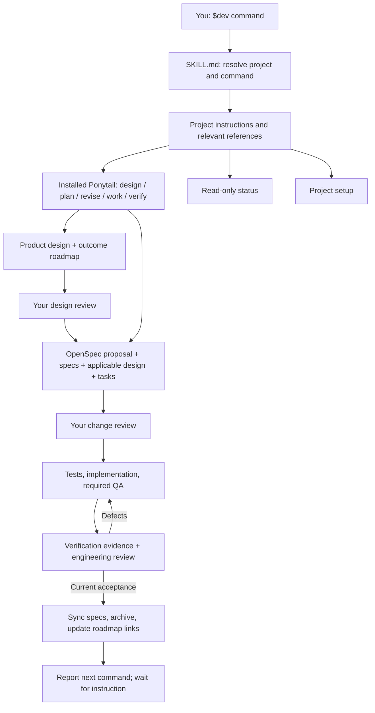

# Architecture and artifact guide

This guide explains the library's structure. The [command reference](commands.md) defines observable command behavior; [engineering and verification](engineering-and-verification.md) defines required engineering and acceptance rules.

## Responsibilities

`dev` is an instruction package executed by Codex. It has no daemon, command parser, scheduler, task database, custom OpenSpec schema, or application runtime.

| Component | Owns | Depends on |
|---|---|---|
| `dev` entrypoint | Operation routing, target resolution, instruction loading, handoff boundaries | Applicable project instructions and selected command reference |
| Product-planning guidance | Product experience, constraints, outcome roadmap, adoption | User goals, existing product evidence, Ponytail |
| Installed OpenSpec workflows | Change scaffolding and native proposal/spec/design/task lifecycle | OpenSpec CLI, configured schema and planning store |
| Installed Ponytail skill | Smallest complete solution across design, plan, revise, work, and review | Actual scope, reusable components, accepted engineering requirements |
| Project tooling | Builds, checks, tests, database acceptance, browser QA | The project's real architecture and execution environment |
| Verification record | Acceptance coverage, tested identity, findings, unresolved gaps | Actual tool results and engineering review |

Product-planning guidance uses the useful design and roadmap concepts of `specify-product`. It does not invoke that skill's compiler, hash-approval runtime, or `develop-product` handoff. The original skills remain unchanged.



`work` owns the full implementation and qualification cycle. `verify` provides a separate evidence review without changing product code or requirements. `finish` consumes current proof; native OpenSpec task completion is an input, not proof by itself.

## Global package files

```text
dev-command-library/
├── README.md
├── .gitignore
├── docs/
│   └── implementation-plan.md
├── skills/
│   └── dev/
│       ├── SKILL.md
│       ├── agents/openai.yaml
│       ├── references/
│       │   ├── architecture.md
│       │   ├── commands.md
│       │   ├── product-planning.md
│       │   ├── openspec-workflow.md
│       │   ├── engineering-and-verification.md
│       │   └── maintenance.md
│       └── assets/templates/
│           ├── design.md
│           ├── roadmap.md
│           └── verification.md
└── tests/
    ├── scenarios.md
    └── evidence/<run-id>.md
```

| File | Contents | Used when |
|---|---|---|
| `README.md` | Human quickstart and navigation | Starting or returning to the library |
| `.gitignore` | Temporary evaluation/caches exclusions | Maintaining source history |
| `docs/implementation-plan.md` | Approved original design, build scope, and acceptance | Understanding initial decisions or auditing the build |
| `SKILL.md` | Skill identity, essential requirements, command routing, target selection | Every invocation |
| `agents/openai.yaml` | Skill-picker display metadata and invocation prompt | Codex discovers or displays the skill |
| `references/architecture.md` | This structural and artifact guide | Understanding or modifying the library |
| `references/commands.md` | Canonical command contract and examples | Running a command or consulting its manual |
| `references/product-planning.md` | Design, roadmap, and adoption procedure | `design` and effort-level `revise` |
| `references/openspec-workflow.md` | Delegation to native OpenSpec capabilities | OpenSpec setup, planning, revision, implementation, and finish |
| `references/engineering-and-verification.md` | Engineering obligations and acceptance criteria | Design/plan decisions, implementation, review, completion |
| `references/maintenance.md` | Installation, updates, evaluations, recovery | Maintaining or repairing the library |
| `assets/templates/design.md` | Product design starting structure | Creating a design without an existing canonical equivalent |
| `assets/templates/roadmap.md` | Outcome, dependency, and change-link structure | Creating an outcome roadmap |
| `assets/templates/verification.md` | Tested identity, coverage, results, findings | Creating a change verification record |
| `tests/scenarios.md` | Realistic prompts, fixtures, observable pass conditions | Evaluating behavior before release or relevant changes |
| `tests/evidence/<run-id>.md` | Actual observed evaluation results | Reviewing release confidence or regressions |

The installed package is self-contained under `skills/dev`. References needed during commands are inside that package. The source README, implementation record, and library evaluation fixtures are human/maintenance resources outside it.

The entrypoint loads the selected command section and relevant reference files progressively. OpenSpec artifact templates and Ponytail rules come from their actual installed providers rather than duplicated snapshots.

## Project artifacts

Default paths are shown below. Existing canonical equivalents take precedence; OpenSpec's CLI-resolved paths and schema are authoritative, including when a separate planning store is configured.

```text
<project>/
├── AGENTS.md
├── .agents/skills/openspec-*/SKILL.md       # generated by OpenSpec
├── docs/development/<effort-id>/
│   ├── design.md
│   └── roadmap.md
├── openspec/
│   ├── config.yaml
│   ├── specs/<capability>/spec.md
│   └── changes/
│       ├── <change-name>/
│       │   ├── .openspec.yaml
│       │   ├── proposal.md
│       │   ├── specs/<capability>/spec.md
│       │   ├── design.md                  # when applicable
│       │   ├── tasks.md
│       │   └── verification.md
│       └── archive/<date>-<change-name>/
├── <existing source and test directories>/
└── <existing QA output directories>/
```

OpenSpec may also generate integration metadata such as `.openspec-target`; its installed CLI owns those files. `$dev` does not manufacture or maintain substitutes.

| Artifact | Owner and content | Writers | Readers |
|---|---|---|---|
| `AGENTS.md` | Project rules, architectural boundaries, test commands, database protections, Ponytail requirement | `setup` preserves and extends existing rules | All project work |
| OpenSpec configuration/integration | Native schema, context, store, and generated skills | OpenSpec initialization; bounded `setup` configuration merge | OpenSpec workflows |
| Product design | Purpose, users, journeys, supported/recovery behavior, acceptance, durable architecture constraints | `design`; effort-level `revise` | `plan`, `work`, acceptance review |
| Roadmap | Outcomes, dependencies, acceptance boundaries, change links | `design`, `plan`, effort-level `revise`, `finish` | Delivery selection and review |
| Change metadata | Native change identity/schema configuration | OpenSpec CLI | OpenSpec workflows |
| Proposal | Reason, bounded scope, impact, upstream outcome or direct request | `plan`; change-level `revise` | `work`, `verify`, `finish` |
| Delta specifications | Required behavior and scenarios | `plan`; `revise` | Implementation, tests, verification, spec sync |
| Technical design | Necessary technical choices, reuse, dependency direction, contracts, migrations | `plan`; `revise` when schema requires | Implementation and engineering review |
| Tasks | Bounded work and verification criteria | `plan`, `revise`, progress during `work` | Work/resume and completion assessment |
| Verification record | Actual current evidence, engineering findings, gaps | `work`, `verify`; invalidation during `revise` | `status`, `finish` |
| Main specifications | Accumulated capability behavior | Successful sync in `finish` | Later change planning |
| Code/tests/config/migrations | Actual solution using existing project structure | `work` | Runtime, test and review tools |
| Raw QA output | Reports, traces, screenshots, logs | Project test tooling | Debugging and evidence inspection |

Product design answers **what experience and outcomes should exist**. Change design answers **how this particular change will implement them**. The roadmap links outcomes to changes; it does not duplicate task checkboxes or create an independent completion counter.

`verification.md` is a library convention. It travels with the archived change, but OpenSpec does not validate its assertions automatically. Evidence references identify their repository/path base so moving a planning directory does not silently point at the wrong report.

## Commands and data flow

| Command | Reads | Writes | Ends at |
|---|---|---|---|
| `setup` | Project instructions, tools, structure, existing configuration | Bounded project instructions and native OpenSpec setup/config | Prepared project or named missing dependency |
| `design` | Goal/source, existing behavior, project rules | Canonical product design and roadmap, or adoption references | Product review |
| `plan` | Outcome/direct request, existing code/contracts/tests, main specs | Native artifacts for one change; applicable roadmap association | Change review |
| `work` | Selected artifacts, current code and evidence | Code/tests/config, task progress, evidence | Accepted change or concrete blocker |
| `verify` | Current artifacts/code/evidence | Verification report and test output | Qualification result |
| `revise` | Feedback and affected planning artifacts | Revised plan, affected task/evidence invalidation | Planning review |
| `finish` | Current qualification evidence and spec deltas | Main specs, archived change, owned roadmap references | One completed change |
| `status` / bare `dev` | Current artifacts and evidence | Nothing | State and next command |

```mermaid
sequenceDiagram
    actor User
    participant Dev as dev skill
    participant Pony as Installed Ponytail
    participant Spec as OpenSpec
    participant Tools as Project tools
    participant Files as Project artifacts
    User->>Dev: design goal
    Dev->>Pony: Load actual rules
    Dev->>Files: Design and roadmap
    Dev-->>User: Reviewable design
    User->>Dev: plan outcome
    Dev->>Spec: Resolve schema/store; scaffold and plan
    Spec->>Files: Proposal, specs, applicable design, tasks
    Dev-->>User: Reviewable change
    User->>Dev: work change
    Dev->>Files: Read plan; update tests and code
    Dev->>Tools: Checks and applicable copied-DB/UI QA
    Tools-->>Dev: Actual results
    Dev->>Files: Verification and task progress
    Dev-->>User: Accepted work or concrete blocker
    User->>Dev: finish change
    Dev->>Files: Check current acceptance and review
    Dev->>Spec: Sync and archive
    Dev->>Files: Update owned roadmap links
    Dev-->>User: Completed change; next command
```

No global active-project pointer exists. Every invocation resolves the current repository and explicit/unambiguous target. State is derived from artifacts and current evidence, not from the last chat message, newest directory, or checked boxes alone.

## Principles and their practical effect

Clean Architecture provides boundaries and dependency direction. Decoupling and SOLID provide focused responsibilities and contracts. Ponytail avoids unnecessary components and abstractions within those requirements. This applies to plans as well as code: a complex accepted plan cannot reliably be simplified only at implementation time.

These are instruction-based obligations backed by project checks and recorded review. Meaningful architecture/import rules, typing, tests, and CI can enforce mechanical properties. Human or independent agent review addresses semantic questions such as whether an abstraction is necessary. The [engineering reference](engineering-and-verification.md) defines the actual gates and freshness requirements.

The first version remains manually driven. Native artifacts make future automation possible, but this package contains no loop or implied permission to start another outcome.
